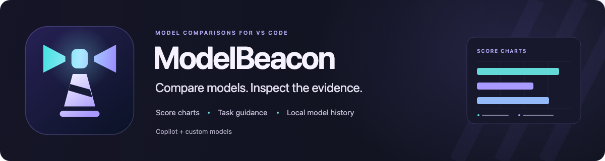
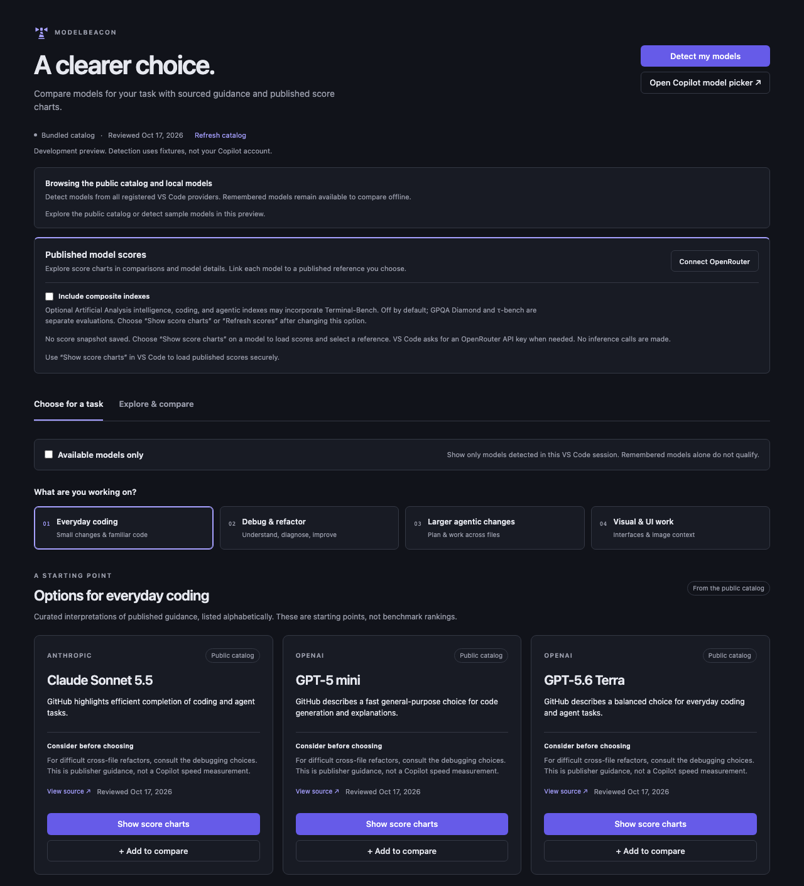
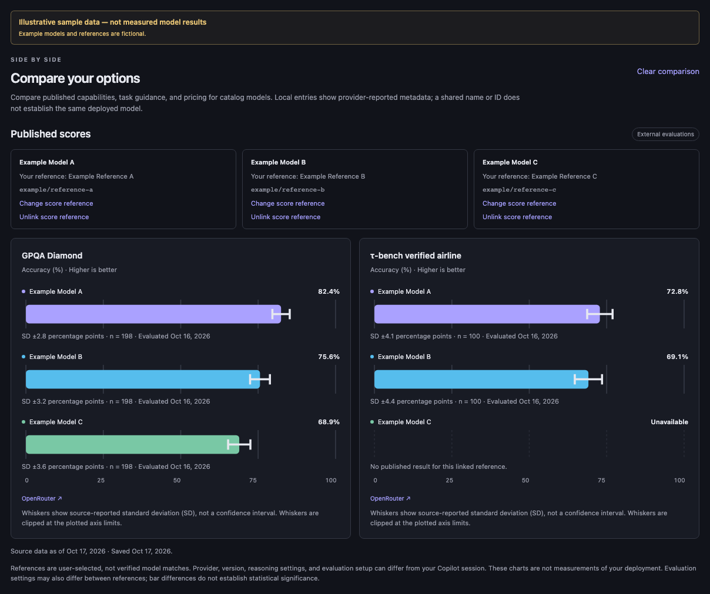
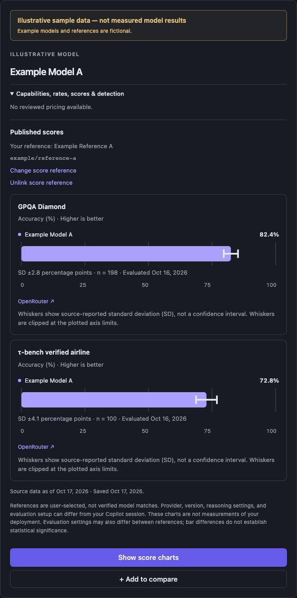

# ModelBeacon

**Compare coding models, explore their scores, and choose with context.**

[Install ModelBeacon from the VS Code Marketplace](https://marketplace.visualstudio.com/items?itemName=mebaysan.modelbeacon)

ModelBeacon brings model comparisons into VS Code. Explore sourced task guidance, compare capabilities and Copilot prices, and connect published evaluation scores to see the evidence in charts. Include models exposed by your organization or installed providers, with your model history and reference choices saved locally.

Built by [mebaysan](https://mebaysan.com). Free and open source. Independent of GitHub and Microsoft.

## From a task to a shortlist

- **Start with your work.** Explore choices for everyday coding, debugging and refactoring, larger agent tasks, or visual/UI work.
- **See the reason behind a suggestion.** Each recommendation includes its rationale, limitations, and source.
- **Compare up to three models.** Review published prices, capabilities, reported model metadata, and available score charts side by side.
- **See scores in context.** Add reasoning and tool-use charts through OpenRouter, with optional intelligence, coding, and agentic indexes. Inspect the same evidence in each model's details.
- **Bring your own model list.** Detect models exposed by Copilot and other installed providers, including organization and custom models.
- **Stay in your workflow.** Open the Activity Bar home view for a quick look or use the editor dashboard for wider comparisons.

*Home view in the development preview, using the bundled public catalog. Recommendations are editorial interpretations of cited sources, not a measured ranking.*

## From model names to visual comparisons

Select up to three models in **Explore & compare**. Adding a model or choosing **View comparison** automatically loads published scores using your saved connection. Model IDs and names resolve published references automatically, with saved manual choices taking precedence. No model-name prompt is required. Each metric has its own chart, readable values, units, source attribution, and dates.

*Development preview of the extension's comparison UI with the default reasoning and tool-use metrics. Example Model A, B, and C and all displayed scores are illustrative sample data, not measured model results.*

The bundled catalog includes **31 models**, with task guidance, capabilities, and published prices sourced from GitHub documentation and reviewed on October 17, 2026. No benchmark score dataset is bundled. Copilot prices are published token rates, not your usage or bill. Custom models can join the comparison with their reported metadata; they do not inherit public-model claims or Copilot prices from similar names.

### Connect the scores you want

1. Choose **Add to compare** on model cards, then **View comparison**. Scores load automatically. You can also choose **Show score charts** for a single model; enter your OpenRouter API key in VS Code's password prompt if you have not connected yet.
2. Charts appear for uniquely matched published references automatically. If a match is missing or ambiguous, it stays unavailable; **Link score reference** is an optional way to choose an alternative. You can change a reference or reset a manual choice to automatic matching.
3. Read the charts in the comparison or expanded details. **Add to compare**, **View comparison**, and **Show score charts** load scores automatically, sharing a download when clicks overlap. **Refresh scores** is also available separately, and cached charts remain visible during a refresh or after a failed download.

You do not need to fetch statistics separately or type a model name to open charts. Matching runs locally against the downloaded public scores. Version and reasoning variants are kept distinct; a similar name alone does not justify substituting another model.

| Chart | Evidence | Availability |
| --- | --- | --- |
| Reasoning | GPQA Diamond accuracy | Default source selection |
| Tool use | τ-bench Verified Airline accuracy | Default source selection |
| Intelligence, coding, and agentic indexes | Artificial Analysis composite indexes reported by OpenRouter | Optional; enable **Include composite indexes**, then choose **Show score charts** or **Refresh scores** |

Composite indexes are **off by default** because their methodology can incorporate Terminal-Bench. ModelBeacon has no direct Terminal-Bench import. Coverage depends on the results OpenRouter provides; there may be no result for a particular model or metric.

### Inspect a model's evidence

Choose **Show score charts** to open a model's details and refresh its scores. References resolve automatically from model identity and names. A manual override, if saved, takes precedence and stays on your machine. Ambiguous matches stay unavailable, and optional reference controls let you choose a different evaluation.

*The same model-details UI in the development preview, with composite indexes disabled. Example Model A and all displayed scores are illustrative sample data, not measured model results.*

Index points stay separate from accuracy percentages. Missing results appear as unavailable, not zero. Where a source reports standard deviation, charts label it as **SD**, not a confidence interval. No overall winner score is calculated, and differences between bars do not establish statistical significance.

A linked reference describes an external evaluation, not your Copilot or organization deployment. Its version, reasoning settings, provider configuration, and evaluation setup may differ. [Data sources and attribution](THIRD_PARTY_NOTICES.md).

## Get started

Requires **desktop VS Code 1.140+**. You can browse the public catalog without Copilot.

1. Install [ModelBeacon from the VS Code Marketplace](https://marketplace.visualstudio.com/items?itemName=mebaysan.modelbeacon).
2. Click the **ModelBeacon** icon in the Activity Bar. Choose **Open in Editor** for the full dashboard.
3. Pick a task, or open **Explore & compare** and add up to three models.
4. Choose **Detect My Models** to include models returned by your installed providers. Enable **Available models only** to filter to the current detection results.
5. Inspect the guidance and sources, then use **Open Copilot model picker** to choose a model in Copilot.

You can also install `modelbeacon.vsix` using **Extensions: Install from VSIX…**. [Building from source or upgrading an earlier local build?](docs/development.md)

## Your model history stays local

ModelBeacon makes **no inference requests**, collects no analytics, and does not read workspace files, prompts, chat history, credentials from installed model providers, or endpoint configurations. Detected model metadata stays in local extension storage; **Clear Local Models** removes that history, current discovery results, and references linked to those runtime identities.

The optional score connection stores the OpenRouter key you explicitly enter in **VS Code SecretStorage**. Model references and cached public scores stay local; private model names and IDs are not sent to OpenRouter. **Add to compare**, **View comparison**, **Show score charts**, **Connect OpenRouter**, and **Refresh scores** contact OpenRouter using that key and ordinary HTTP metadata; reference controls also download scores when no snapshot is cached. Opening the extension or reading already expanded charts makes no score request. **Disconnect & clear scores** removes the key, scores, and reference choices while keeping discovered model history and the GitHub catalog.

Saved models remain useful offline and show their last-seen date. They are not treated as currently available. Discovery starts when requested and can refresh after provider changes during that session; opening a saved cache does not query providers.

Builds with a configured public catalog feed can check for updates at most once daily when opened. Turn automatic checks off with `llmBench.autoUpdateCatalog`. Local builds have no feed by default. [Read the privacy policy](PRIVACY.md).

## Common questions

**I connected OpenRouter, but why are there no charts?**  
Choose **View comparison** after adding models: it loads scores and resolves references automatically, without opening a model-name picker. **Show score charts** does the same for one model. If the downloaded data has no unique match, an optional reference control is available; a missing public result cannot be generated. A missing metric stays unavailable; intelligence, coding, and agentic indexes also require **Include composite indexes** before opening charts or refreshing. Re-entering your API key is unnecessary when the download succeeded. If a refresh fails, previously saved charts remain available.

**Does ModelBeacon run benchmarks or pick a winner?**  
It does not run evaluations. It presents sourced editorial guidance, capabilities, prices, and optional published scores from OpenRouter. It makes no inference requests, generates no universal score, and does not switch your model automatically. Score charts do not change the editorial task recommendations.

**Will it show every model in my picker?**  
It shows models exposed through VS Code's stable Language Model API. Results can differ from a provider's picker and do not prove subscription entitlement. The availability filter uses current detection results; cached models do not count, and failed detection does not substitute public-catalog models. Organization policies and Auto-only plans can limit selection.

**Can I compare an organization or custom model?**  
Yes, if its installed provider exposes it through the API. Compare its name, provider, version, and reported input limit beside public models. ModelBeacon resolves a unique public reference from its ID or name where possible. An optional manual override remains available; missing or ambiguous results stay unavailable. An input limit is not an advertised context window. ModelBeacon does not configure providers, provision endpoints, or accept custom benchmark uploads.

## Commands

Find these in the Command Palette under **ModelBeacon**:

| Command | What it does |
| --- | --- |
| Open in Editor | Open or reveal the comparison dashboard. |
| Detect My Models | Refresh the models exposed by your installed providers. |
| Refresh Catalog | Request the latest catalog from the configured feed. |
| Clear Local Models | Remove saved metadata, current discovery, and runtime reference links; keep the public catalog. |
| Connect OpenRouter Scores | Save an OpenRouter API key securely and download public scores. |
| Refresh Model Scores | Download the selected public score sources again. |
| Disconnect and Clear Scores | Delete the OpenRouter key, score cache, and local reference choices. |

[Development and installation](docs/development.md) · [Catalog sources and maintenance](docs/catalog.md) · [Release validation](docs/validation.md) · [Changelog](CHANGELOG.md)

Code: [MIT](LICENSE). Data: [source licenses and attribution](THIRD_PARTY_NOTICES.md).

## Publishing from GitHub

The public [mebaysan/modelbeacon repository](https://github.com/mebaysan/modelbeacon) hosts the listing images. Push a stable version increase to `main` and **Release and publish extension** validates the build, creates a GitHub Release with a downloadable VSIX, and publishes that package to Marketplace using repository secrets. See [publisher setup and release steps](docs/development.md#publishing).
